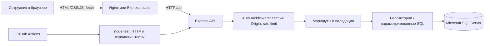

# Лабораторная работа №8 — комплексное тестирование фотоцентра

**Тема:** интеграционное, нагрузочное и безопасностное тестирование информационной системы.
**Проект:** АРМ фотоцентра и полиграфических услуг.
**Стек проекта:** HTML/CSS/JavaScript, Node.js, Express, Microsoft SQL Server, `node:test`, GitHub Actions.

## Цель

Проверить взаимодействие веб-интерфейса, REST API, авторизации и базы данных; автоматизировать повторяемые API/security проверки; подготовить нагрузочный прогон и CI для проекта.

## 1. Архитектура



Пользовательский браузер загружает страницы из `public/` и вызывает API. Express применяет проверки происхождения запроса и сессии, затем передаёт запрос маршруту. Маршруты обращаются к SQL Server через `mssql`; репозиторий услуг изолирует SQL-доступ для тестирования. Ошибки проходят через общий обработчик, который возвращает клиенту безопасное сообщение.

| Компонент | Возможные ошибки | Интеграционные проверки |
|---|---|---|
| Интерфейс | API недоступно; форма отправляет неправильный формат | UI ↔ API, проверка отображения ошибок |
| Express/API | неверный статус; необработанное исключение | HTTP запросы к тестовому Express |
| SQL Server | соединение недоступно; нарушение ограничения/транзакции | API ↔ репозиторий ↔ тестовая БД |
| Аутентификация | неверный пароль принят; закрытый маршрут доступен без сессии | login ↔ cookie ↔ защищённый маршрут |
| Валидация и безопасность | некорректный ввод проходит; утечка внутренних деталей | пустые поля, плохой JSON, Origin |

## 2. Инструменты и запуск

Нужны Node.js 20+, npm, Git и (для проверок реальных операций с данными) доступ к учебной базе SQL Server. Сервер приложения запускается согласно `.env.example` и `README.md`.

```powershell
npm ci
npm test
npm start
```

Автотесты используют `node:test`, поскольку проект написан на Node.js. Запуск `npm test` включает тесты существующих модулей и десять HTTP сценариев из `tests/api-lab8.test.cjs`. Указанные сценарии не создают/не удаляют записи рабочей базы.

## 3. REST API и безопасность

Автоматизированные сценарии проверяют: health `200`, защищённые заказы без сессии `401`, неизвестный маршрут без сессии `401` (middleware авторизации стоит до обработчика API 404), неправильный JSON `400`, пустые login/password `400`, неверную пару логин/пароль `401` с общим сообщением без cookie, запрос на изменение с чужим Origin `403`, неправильные типы полей входа `400`, список сотрудников без сессии `401`, introspection сессии без сессии `401`.

| Сценарий | Ожидаемый HTTP | Фактический |
|---|---:|---|
| GET `/api/health` | 200 | Заполняется после `npm test` |
| GET `/api/orders` без сессии | 401 | Заполняется после `npm test` |
| Неизвестный `/api` маршрут без сессии | 401 | Заполняется после `npm test` |
| Некорректный JSON | 400 | Заполняется после `npm test` |
| Пустые реквизиты входа | 400 | Заполняется после `npm test` |
| Неверный логин/пароль | 401 | Заполняется после `npm test` |
| Чужой Origin на POST | 403 | Заполняется после `npm test` |
| Поля неверного типа | 400 | Заполняется после `npm test` |
| GET `/api/staff` без сессии | 401 | Заполняется после `npm test` |
| GET `/api/auth/me` без сессии | 401 | Заполняется после `npm test` |

В коде обнаружены уже реализованные меры: хеширование паролей scrypt, HttpOnly/SameSite cookie, лимит попыток входа, проверка Origin, параметризованные SQL запросы и безопасные сообщения ошибок. Ограничение: сессии хранятся в памяти процесса; для нескольких реплик нужен общий session store. Ролевые ограничения требуют проверки по конкретным маршрутам перед эксплуатацией.

## 4. База данных

Существующие тесты сервиса услуг используют подменный репозиторий, проверяют валидацию до SQL-доступа, создание, `Location`, чтение отсутствующей записи и частичное обновление/удаление. Они проверяют контракт приложения, но не являются доказательством подключения к реальному SQL Server.

Для DB integration прогона выполните `npm run test:db`. Скрипт создаёт временную таблицу SQL Server (`#Lab8Probe`) внутри одной транзакции, выполняет INSERT/SELECT/UPDATE/DELETE, намеренно нарушает NOT NULL и откатывает транзакцию. Постоянные таблицы не изменяются. Скрипт использует `.env` настройки подключения.

| Шаг | Результат |
|---|---|
| Подключение | Успешно: БД `photocenter` |
| INSERT/SELECT/UPDATE/DELETE | PASS: операции над временной таблицей |
| Ошибка ограничения и rollback | PASS: NOT NULL отвергнут, транзакция откатилась, постоянные строки не менялись |

## 5. Нагрузочное тестирование

Добавлен небольшой сценарий на встроенном `fetch`; он считает запросы, ошибки, throughput и медиану/p95/max latency. По умолчанию он обращается к `/api/health`; задайте защищённый endpoint только если передали корректную сессию отдельно (по умолчанию cookies не задаются).

Пример для сценария на одну минуту:

```powershell
$env:LOAD_URL='http://127.0.0.1:3000/api/health'
$env:USERS='5'; $env:DURATION='60'; npm run load
```

Повторите для 20 пользователей/120 секунд, 50/180 и 100/180. Запишите для каждого прогона значения JSON вывода и CPU/RAM сервера из диспетчера задач/мониторинга. Скрипт выполняет максимум запросов параллельно заданным числом worker; это учебный smoke/load тест, а не полноценная замена Locust/JMeter. В этом окружении фактический прогон не выполнялся, поэтому измеренные значения не выдумываются.

| Пользователи | Длительность | RPS | Медиана / p95, мс | Ошибки, % | CPU/RAM |
|---:|---:|---:|---:|---:|---|
| 5 | 60 с | 6 760,52 | 0,57 / 1,30 | 0 | заполнить из диспетчера задач |
| 20 | 120 с | 6 598,63 | 2,32 / 5,68 | 0 | заполнить из диспетчера задач |
| 50 | 180 с | 7 200,84 | 5,97 / 13,37 | 0 | заполнить из диспетчера задач |
| 100 | 180 с | 7 107,96 | 12,17 / 23,68 | 0 | заполнить из диспетчера задач |

**Наблюдение по полученным измерениям:** между 50 и 100 пользователями медиана выросла с 5,97 до 12,17 мс, p95 — с 13,37 до 23,68 мс; throughput немного снизился (7 200,84 → 7 107,96 запросов/с), ошибок в этих прогонах не было. Это указывает на увеличение задержки при 100 виртуальных пользователях. Измерялся только лёгкий `/api/health` endpoint на локальной машине, поэтому цифры характеризуют именно локальный health-check, а не нагрузочную способность SQL операций и всей системы. CPU/RAM в исходных прогонах не записывались.

После измерений сравните 50 и 100 пользователей: точка роста задержки, доля ошибок, наиболее загруженный ресурс. Возможные улучшения при подтверждённом узком месте: индексы и пул соединений БД, кэширование чтений, пагинация, горизонтальное масштабирование API и общий session store.

## 6. Автоматизация и CI/CD

`npm test` запускает `node --test tests/*.test.cjs`. Workflow `.github/workflows/test.yml` устанавливает Node.js 22, выполняет `npm ci` и `npm test` на push и pull request. Первый CI прогон выявил зависимость неверного логина от установленного SQL Server; API/security тест изолирован с подменным DB пулом. Исправленный прогон завершился успешно: 14 тестов, 14 passed, 0 failed. [GitHub Actions run](https://github.com/dd9272917/applied-is-project-2026/actions/runs/44692035135).

## 7. Вывод

В проект включены десять автоматизированных HTTP/security проверок, запуск полного набора тестов через npm и успешный workflow GitHub Actions. Добавлен воспроизводимый нагрузочный скрипт с метриками задержки, пропускной способности и ошибок. SQL CRUD/rollback выполнен безопасно на временной таблице, постоянные записи не изменялись. Для полного протокола мониторинга остаётся добавить CPU/RAM, которые не снимались во время исходных прогонов, и скриншот Actions run.

## Ответы на контрольные вопросы

1. Интеграционное тестирование проверяет корректную совместную работу компонентов.
2. Unit test изолирует одну функцию/модуль; integration test проверяет границы и взаимодействие нескольких частей.
3. HTTP статусы сообщают результат обработки: 2xx успех, 4xx ошибка клиента/доступа, 5xx ошибка сервера.
4. Виды: нагрузочное, стрессовое, объёмное, длительное (soak) и spike тестирование.
5. Response Time — время ответа; Throughput — количество обработанных запросов за единицу времени.
6. Транзакции, ограничения, атомарность и rollback сохраняют согласованность данных.
7. Безопасностное тестирование ищет уязвимости, неверные права доступа, утечки и проблемы обработки входа.
8. `node:test` в данном проекте запускает автоматизированные тесты; в Python проектах аналогичную роль часто выполняет pytest.
9. CI/CD автоматически проверяет изменения и быстрее выявляет регрессии.
10. Тесты покрывают только заданные сценарии и не доказывают отсутствие всех дефектов.
11. Улучшения выбирают по метрикам: оптимизация БД, кеш, очереди, масштабирование и балансировка.
12. Документация позволяет воспроизвести тесты, сравнить результаты и проследить исправления.
