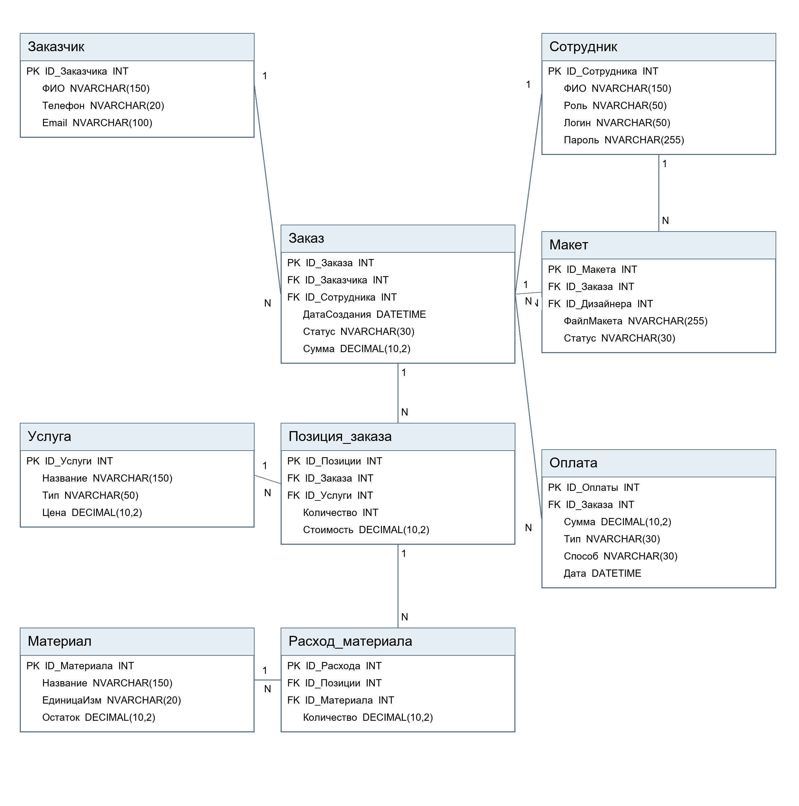

# АРМ фотоцентра и полиграфических услуг

## Лабораторные работы 1 и 2

Информационная система автоматизирует приём заказов фотоцентра, учёт услуг,
материалов, макетов и оплат. Материалы лабораторных адаптированы к стеку
Node.js, Express и Microsoft SQL Server.

Отчёты и инструкция: [labs/README.md](labs/README.md).
Для лабораторной №2 подготовлены скрипты создания отдельной учебной БД,
заполнения девяти таблиц тестовыми данными и проверки связей в `labs/sql/`.

### ER диаграмма



Редактируемая схема: [ER_фотоцентр.drawio](labs/ER_фотоцентр.drawio).

Прототип сайта (слой представления + бизнес-слой + слой доступа к данным)
для лабораторной работы №3 «Проектирование интерфейса пользователя»
(курс «Архитектура программного обеспечения инфокоммуникационных систем»).

Стек: **HTML/CSS/JS** (фронтенд) + **Node.js / Express** (бэкенд) +
**Microsoft SQL Server** через пакет `mssql`.

## 1. Установка

```bash
cd photocenter-app
npm install
```

## 2. Настройка подключения к БД

1. Скопируйте `.env.example` в `.env`:
   ```bash
   copy .env.example .env      (Windows)
   cp .env.example .env        (macOS/Linux)
   ```
2. Откройте `.env` и укажите параметры вашего SQL Server (сервер, имя БД,
   логин/пароль или Windows-аутентификацию — при необходимости отредактируйте
   `db.js`).
3. Если у вас **уже есть** база данных в SSMS — просто укажите её имя в
   `DB_DATABASE` и убедитесь, что названия таблиц/столбцов совпадают со
   схемой в `schema.sql` (она построена по вашей ER-диаграмме). Если названия
   отличаются — либо переименуйте столбцы в БД, либо поправьте SQL-запросы
   в `routes/*.js`.
4. Если базы ещё нет — выполните `schema.sql` в SSMS (создаст БД
   `PhotoCenterDB`, все таблицы и немного тестовых данных).

## 3. Запуск

```bash
npm start
```

Сайт будет доступен на **http://localhost:3000**.

Для разработки с автоперезапуском:
```bash
npm run dev
```

## 4. Структура проекта (соответствует слоям архитектуры из методички)

```
photocenter-app/
├── server.js              # точка входа, централизованная обработка ошибок
├── db.js                  # слой доступа к данным: пул подключений к SQL Server
├── schema.sql              # DDL-скрипт БД по ER-диаграмме проекта
├── routes/                 # компоненты доступа к данным + бизнес-логика
│   ├── clients.js           #   Заказчики (CRUD)
│   ├── services.js          #   Услуги (CRUD)
│   ├── materials.js         #   Материалы (CRUD + остатки)
│   ├── staff.js              #   Сотрудники (список)
│   ├── orders.js             #   Заказы, позиции, расход материалов, оплата, макеты
│   └── dashboard.js          #   Агрегированная статистика для панели
├── utils/
│   ├── asyncHandler.js      # сквозная функциональность: перехват исключений
│   └── AppError.js          # управляемая ошибка с безопасным сообщением
└── public/                  # слой представления
    ├── index.html            # Панель (дашборд, конвейер заказов)
    ├── orders.html            # Список заказов
    ├── order-detail.html      # Карточка заказа (позиции, материалы, оплата, макеты)
    ├── clients.html            # Заказчики
    ├── services.html           # Каталог услуг
    ├── materials.html          # Материалы и остатки
    ├── css/style.css            # дизайн-система (цвета, типографика, компоненты)
    └── js/
        ├── api.js                # компонент логики представления: обёртка над fetch,
        │                          # централизованная обработка ошибок на клиенте
        └── nav.js                 # компонент UI: общая навигация/шапка
```

## 5. Что реализовано из требований лаб. 3

- **Тип приложения / технология UI:** веб-клиент, HTML+CSS+JS без
  фреймворка, обмен с сервером через `fetch`/JSON (AJAX).
- **Компоненты UI:** страницы-«представления» (`*.html`) отображают данные
  и собирают пользовательский ввод, не обращаясь к БД напрямую.
- **Компоненты логики представления:** `api.js` (единая точка вызовов API,
  разбор ошибок), `nav.js` (общая навигация), функции `render()` на каждой
  странице готовят данные к отображению отдельно от их получения.
- **Валидация:** на клиенте — атрибуты `required`/`min`/`type` и проверка
  перед отправкой; на сервере — повторная проверка в `routes/*.js`
  (обязательна, т.к. клиентскую проверку легко обойти).
- **Обработка ошибок:** каждый маршрут пробрасывает ошибку в
  `server.js` → централизованный `app.use((err, req, res, next) => …)`,
  который логирует полную ошибку на сервере и возвращает пользователю
  только безопасное сообщение (без деталей SQL/стека).

## 6. Дальнейшее развитие (вне рамок лаб. 3)

- Полноценная аутентификация сотрудников (сейчас — простой выбор из списка).
- Загрузка файлов макетов на диск/в облако вместо текстового поля с именем.
- Печать квитанций/чеков по заказу.

## Вход сотрудников

Откройте `/login.html` и введите логин и пароль из существующей таблицы `Сотрудник` (столбцы `Логин`, `Пароль`). Новый SQL-скрипт выполнять не нужно. Не запускайте `schema.sql` поверх рабочей базы: он пересоздаёт таблицы.

Если база создана из демонстрационного `schema.sql`, учётные записи: `ivanova`, `petrov`, `sidorova`; начальный пароль — `demo`. Эти данные подходят только для учебной локальной базы.

После первого успешного входа старый пароль автоматически заменяется в базе на хеш scrypt с индивидуальной солью. Клиент получает только имя, роль и идентификатор сотрудника. Сессия хранится в HttpOnly/SameSite cookie и действует 8 часов. Перезапуск сервера завершает все сессии. Повторный вход после перезапуска — ожидаемое поведение.

Все API и HTML-страницы приложения, кроме страницы входа, требуют сессии. Автор нового заказа определяется сервером из сессии, поле сотрудника из запроса не используется. Роли пока отображаются как сведения о сотруднике; отдельные права администратора и управление учётными записями в интерфейсе не реализованы.

После обновления кода перезапустите сервер (`Ctrl+C`, затем `npm start`) и обновите браузер (`Ctrl+F5`).

Если при входе возникает ошибка из-за короткого поля `Пароль` (в старых базах `NVARCHAR(100)`), выполните `node scripts/migrate-auth.js`. Команда увеличивает поле до `NVARCHAR(255)` и сохраняет данные; её можно запускать повторно. Она использует подключение из `.env`.
